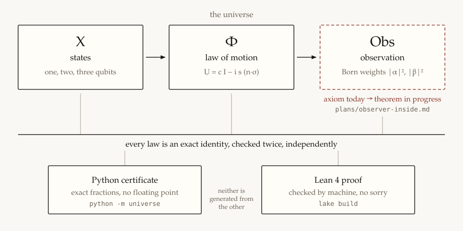
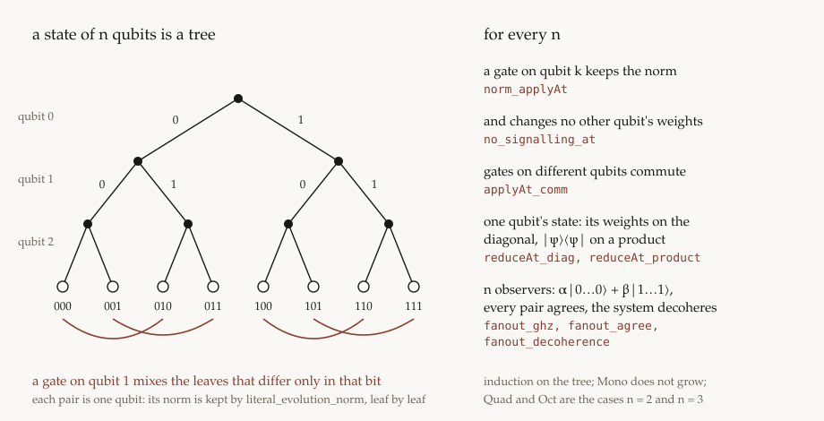

# universe

[](https://github.com/gianlucamazza/universe/actions/workflows/check.yml)

A tiny quantum universe in which every law is a proved theorem.

## In plain words

Quantum mechanics describes a world with three ingredients: the states it can be in, the rule by which those states change in time, and what can be observed. This repository builds the smallest such world, a single qubit and then a few qubits together, and proves every statement about it **exactly**. There are no floating-point numbers, no approximations, and no "it looked right in a simulation".

Every fact is checked twice, independently:

- a Python program recomputes it with exact fractions and fails if anything is off;
- a Lean 4 proof is checked by a machine.



**Nothing here is new physics.** Every statement is textbook quantum mechanics. What is new is the object: a complete, certified model in which nothing is assumed without being written down and proved.

### Where it is going

1. **One qubit in time.** It evolves without losing probability, and the measurement probabilities add up to 1. Done.
2. **Several qubits together.** Two systems combine into one, and the order in which three are grouped does not matter. Done.
3. **The observer inside.** Measurement used to be an _axiom_: the model was told from outside what an observation returns. Now a second qubit, an _apparatus_, interacts with the system through a `CNOT` gate, and the rest is proved. Done:
   - the interaction entangles system and apparatus: their joint state is no longer two separate states;
   - the apparatus reads exactly the probabilities the axiom assumed, and the system, seen alone, loses its coherence;
   - two apparatuses on the same system never disagree, whatever the order in which they look;
   - nothing done to an apparatus changes what the system does.

   What this settles and what it does not is in [`researches/osservatore.md`](researches/osservatore.md).

4. **Nothing from outside.** The pieces the model still took for granted are now proved too. Done:
   - the interaction is not a hand-written gate: it comes from a Hamiltonian, and `CNOT` is one of its points;
   - measurement comes in degrees, from no coupling to a perfect one;
   - reading the apparatus updates the system by the textbook rule, and a second reading repeats the first;
   - energy is conserved, two steps of time make one step, and a change of basis gives the same universe;
   - two rotations about different axes make one rotation, and their order matters.

5. **An observer on an observer.** Wigner reads a friend who has read the system. Done:
   - reading the friend is reading the system, and the two never disagree;
   - Wigner can undo the friend's measurement, and the system's coherence comes back, until the friend's record has been copied;
   - nothing done to the friend or to Wigner changes what the system does.

6. **Any number of qubits.** The structural theorems hold for `n` qubits, for every `n`, not for two and three separately. Done: a gate on one qubit keeps the norm and changes no other qubit's weights; gates on different qubits commute; `n` observers on one system all agree, and the system decoheres.

   What comes next, and what "complete" means here, is [`plans/roadmap.md`](plans/roadmap.md).

The model does not simulate our universe, and it does not try to. It is a laboratory where the parts of a physical theory can be made exact one at a time.

### Glossary

| Term            | Meaning here                                                                                         |
| --------------- | ---------------------------------------------------------------------------------------------------- |
| qubit           | the simplest quantum system: two amplitudes `α`, `β`, with `\|α\|² + \|β\|²` the total probability   |
| `X`, `Φ`, `Obs` | the states, the law of motion, the observation                                                       |
| `U`             | one step of the law of motion, a 2×2 complex matrix                                                  |
| `c`, `s`        | the cosine and sine of the rotation angle, kept as symbols with `c² + s² = 1`                        |
| `n`             | the rotation axis, a unit vector                                                                     |
| Born weight     | the probability of an outcome, the squared modulus of an amplitude                                   |
| entanglement    | a state of two systems that cannot be written as one state for each                                  |
| apparatus       | a qubit that interacts with the system and records it                                                |
| partial trace   | the state of one part of a composite system, with the other part ignored                             |
| decoherence     | the loss of the off-diagonal terms of that state once the system is recorded                         |
| purity          | `1` for a state known exactly, below `1` for a mixture                                               |
| free ring       | polynomials with no rule imposed: an identity there holds for every value of the symbols             |
| `gC`, `gN`      | the two rules `c² + s² − 1` and `nx² + ny² + nz² − 1`                                                |
| `gA`            | the rule that the amplitudes are normalized, `\|α\|² + \|β\|² − 1`                                   |
| `δ`             | the single defect `gC + s² gN` that pays for unitarity                                               |
| ideal           | everything that vanishes once some rules hold; "in the ideal `(gC, gN)`" means "zero on the circle"  |
| cofactors       | the receipt of a proof: they show exactly how an identity follows from the rules                     |
| `3/5`, `4/5`    | a rational point on the circle, the 3-4-5 triangle, where every prediction becomes an exact fraction |

## Getting started

Requirements: Python 3.11 or later, and Lean 4 through [elan](https://github.com/leanprover/elan) (the version is pinned in `lean-toolchain`). There are no other dependencies: no Mathlib, no numerical libraries.

```sh
pip install -e . --group dev   # pytest, pinned ruff and mypy (pip ≥ 25.1)
python -m universe        # the Python certificate
lake build                # the Lean proofs
./check.sh                # every gate, as in CI
```

`python -m universe` exits 0 only when every algebraic identity has remainder zero and the free-ring cofactors rebuild the original polynomial. It prints 76 lines, each marked `[dimostrato]`. `lake build` typechecks the library `Universe`.

`./check.sh` runs every gate of CI locally: ruff (pinned 0.17.0, recommended rule set), mypy on `universe/`, prettier on the Markdown, the unit tests in `tests/`, the certificate, and `lake build --wfail` (warnings fail the build; `autoImplicit` is off). Three tests guard the documentation: `tests/test_lean_citations.py` fails when Python or the docs cite a `Universe.*` name that Lean does not declare, `tests/test_doc_counts.py` fails when a doc quotes the wrong number of certificate lines, and `tests/test_lean_map.py` fails unless every certificate line is mapped, in `universe/lean_map.py`, to Lean theorems that exist. GitHub Actions runs the same gates on every push, with actions pinned by commit SHA and kept current by Dependabot.

## Repository layout

| Path              | Content                                                                                                                                                                                                                                                                                       |
| ----------------- | --------------------------------------------------------------------------------------------------------------------------------------------------------------------------------------------------------------------------------------------------------------------------------------------- |
| `universe/`       | the Python certificate: `ring.py` (exact scalars, quotient, cofactors), `ontology.py`, `dynamics.py`, `epistemology.py`, `observer.py`, `interaction.py`, `qubits.py` (states of `n` qubits), `proofs.py`, `lean_map.py` (certificate line → Lean theorems), `worlds/qubit.py`, `__main__.py` |
| `Universe/`       | the Lean library, one module per layer: `Ring`, `Quotient`, `Series`, `Dynamics`, `Qubit`, `Epistemology`, `Evaluation`, `Ontology`, `Composition`, `Qubits`, `Observer`, `Symmetry`, `Interaction`                                                                                           |
| `tests/`          | unit tests of the Python side and the documentation guards                                                                                                                                                                                                                                    |
| `.github/`        | the CI workflow and the Dependabot configuration                                                                                                                                                                                                                                              |
| `papers/qubit.md` | the formal note: which identity lives in which ideal                                                                                                                                                                                                                                          |
| `papers/figures/` | the figures, hand-written SVG                                                                                                                                                                                                                                                                 |
| `researches/`     | arguments behind single results                                                                                                                                                                                                                                                               |
| `plans/`          | work plans: executed, in progress, and the roadmap to 1.0                                                                                                                                                                                                                                     |

The README is in English. The notes in `papers/` and `researches/`, the docstrings and the certificate output are in Italian.

## How the proofs work

The universe is the triple `(X, Φ, Obs)`. `X` is a finite-dimensional state space. `Φ` is `exp(−i φ n·σ)`, written in closed form as `U = c I − i s H` with `H = n·σ`; `c` and `s` stay symbols, bound only by `c² + s² = 1` and `|n| = 1`. `expCoeff_hamiltonian` is what licenses that closed form: `H² = I`, so the series of `exp` collapses to cosine and sine. Two representations are the same universe when an isomorphism commutes with `Φ` and `Obs`.

A statement is a polynomial identity. It is proved when its left side minus its right side reduces to zero under the rules, and the proof keeps the **cofactors**: the free-ring expansion `p = Σ fᵢ gᵢ` that rebuilds the polynomial from the rules. Python exhibits those cofactors and checks the expansion. Lean proves the same identities for every polynomial over a monomial of eighteen named exponents (`c s nx ny nz` for the law, eight for the amplitudes of two qubits, `c2 s2` for a second time step, `mx my mz` for a second axis). States of `n` qubits do not widen it: they are trees of polynomials, and their theorems hold for every state. `Universe.Dynamics.reduce_complete` is the converse: membership in `(gC, gN)` means every coefficient of the remainder is zero. Cofactors are a witness, and they are not unique. Neither certificate is extracted from the other.

The statements separate by the rules they need:

- **free ring**, no rule: `H† = H`, `|z|² = re(z)² + im(z)²`, `⟨ψ|Π₀|ψ⟩ = |α|²`, the tensor identities, `CNOT² = I`, decoherence, the apparatus reading the Born weights, two observers agreeing;
- **`(gC, gN)`**, the circle and the axis, one defect `δ = gC + s² gN`: `U†U = I`, `UU† = I`, `det U = 1`, norm preservation, `P(0) + P(1) = 1` on evolved `|0⟩`, no-signalling;
- **`(gC, gN, gA)`**, adding normalized amplitudes: `P(0) + P(1) = 1` on a generic state, and `1 − purity = 2|α|²|β|²` after the apparatus records the system;
- **`(gN)`** alone: two time steps about one axis make one (`evolution_compose`);
- **`(gC, gC2)`** and **`(gC, gN, gC2, gM)`**, with the rules of a second time step and a second axis: the composed angle stays on the circle, and a product of rotations about two axes stays unitary.

The rational point `c = 3/5`, `s = 4/5`, `n = eₓ` turns those polynomials into fractions: `δ` evaluates to zero there, and `9/25`, `16/25` are the squares of `3/5`, `4/5`.

## One qubit

`U†U − I`, `UU† − I` and `det U − 1` lie in `(gC, gN)` with the same cofactors `gC + s² gN`. `literal_sandwich` gives the literal modulus `‖Uψ‖²` and the sandwich `ψ†(U†U)ψ` the same coefficients for every matrix, so `literal_evolution_norm` and `literal_sphere` carry the ideal memberships onto `‖Uψ‖² − ‖ψ‖²` and `‖Uψ‖² − 1`. Python reduces those polynomials, and the sphere line uses `certify_extra` to add `gA` next to the two rules of the ring.

`keepX` and `keepZ` specialize the axis; `specX_pmul` and `specZ_pmul` make that a ring homomorphism. Along x the coefficients of `gN` vanish and the circle remains: `P(0) = 1 − s²`, `P(1) = s²`. Along z, `|0⟩` is an eigenstate: the second amplitude is the zero polynomial and `P(0) = 1`.


| reading                  | P(0)   | P(1)  |
| ------------------------ | ------ | ----- |
| along x                  | 1 − s² | s²    |
| along z                  | 1      | 0     |
| c = 3/5, s = 4/5, n = eₓ | 9/25   | 16/25 |

**Energy is conserved.** `U = c I − i s H` commutes with `H` already in the free ring, since `UH` and `HU` are both `c H − i s H²` (`evolution_commutes_hamiltonian`). So `U†HU = U†UH`, and `⟨Uψ|H|Uψ⟩ − ⟨ψ|H|ψ⟩` lies in `(gC, gN)` for every amplitude (`energy_conserved`). At the rational point `⟨0|H|0⟩` is `0` along x and `1` along z, before and after the evolution.

**Time composes.** Two steps of the law are one step: `U(c₁, s₁) U(c₂, s₂) = U(c₁c₂ − s₁s₂, s₁c₂ + c₁s₂)` modulo `gN` alone (`evolution_compose`). The group law does not use the circle; staying on it does, with `c² + s² − 1 = (c₂² + s₂²) gC₁ + gC₂` (`compose_circle`). `(3/5, 4/5)` composed with itself is `(−7/25, 24/25)`, and `U²|0⟩ = −7/25 |0⟩ − 24/25 i |1⟩`, evaluated in Lean by `evalAt2`, which also reads `c2 s2` (`point_compose`).


**Two axes, and order.** Rotations about different axes compose too. The product of two Pauli matrices is `(n·σ)(m·σ) = (n·m) I + i (n×m)·σ` with no rule at all (`pauli_product`), and so `U(c₁, s₁, n) U(c₂, s₂, m) = a I − i (b·σ)` in the free ring, with `a = c₁c₂ − s₁s₂ (n·m)` and `b = s₁c₂ n + c₁s₂ m + s₁s₂ (n×m)` (`evolution_compose_axes`). With `m = n` it gives back the same-axis law, modulo `gN` (`compose_axes_same`). The product is still a rotation: `a² + |b|²` is the product of the two norms in the free ring (`axes_norm_free`, Euler's four-square identity), so `a² + |b|² − 1` lies in `(gC, gN, gC2, gM)`, with `gM` the rule of the second axis (`compose_axes_norm`). The term `n×m` changes sign with the order: at `n = eₓ`, `m = e_z` and `(3/5, 4/5)` twice, `UₙUₘ|0⟩` and `UₘUₙ|0⟩` differ in the amplitude of `|1⟩`, `−16/25 − 12/25 i` against `16/25 − 12/25 i`, with the same Born weights `9/25` and `16/25` (`point_axes`, `rotations_noncommute`).


**A change of basis is the same universe.** For any matrix `V` with `V†V = I`, `V(Uψ)` equals `(VUV†)(Vψ)` (`conj_evolution`), and the Born weights of `Vψ` in the basis `V|k⟩` equal those of `ψ` (`conj_born`): the rotated description evolves and observes exactly like the original, which is the identity principle of the kernel. With `V†V = I` modulo `(gC, gN)` the same holds modulo the ideal (`conj_evolution_rel`, `conj_born_rel`), so it applies to the symbolic law itself, `V = U` (`conj_evolution_law`, `conj_born_law`). At the rational point, `V(U|0⟩) = −7/25 |0⟩ − 24/25 i |1⟩` (`point_conj_evolution`).

## Several qubits

The cell of `|i⟩ ⊗ |k⟩` is `2·i + k`. `kronecker_ui_gen` is `(U ⊗ I)(|ψ⟩ ⊗ |φ⟩) = (U|ψ⟩) ⊗ |φ⟩` for every second factor, and `marginal_left_gen` multiplies the Born weights by `‖φ‖²`; on a generic factor that scale is removed by the cofactor of `gA`. Python compares the case `|φ⟩ = |0⟩`, where the scale is the constant `1`.

Three qubits can be grouped two ways. `tensor_assoc` says the two groupings are the same eight amplitudes, and `tensor_assoc_ui` and `tensor_assoc_ui_right` say that evolving the first factor commutes with the grouping. `tensor_assoc_obs` gives the two groupings the same Born weights.


The cell of `|i⟩ ⊗ |j⟩ ⊗ |k⟩` is `4·i + 2·j + k`, in both constructions:

| cell | i   | j   | k   | amplitude |
| ---- | --- | --- | --- | --------- |
| 0    | 0   | 0   | 0   | ψ₀ φ₀ χ₀  |
| 1    | 0   | 0   | 1   | ψ₀ φ₀ χ₁  |
| 2    | 0   | 1   | 0   | ψ₀ φ₁ χ₀  |
| 3    | 0   | 1   | 1   | ψ₀ φ₁ χ₁  |
| 4    | 1   | 0   | 0   | ψ₁ φ₀ χ₀  |
| 5    | 1   | 0   | 1   | ψ₁ φ₀ χ₁  |
| 6    | 1   | 1   | 0   | ψ₁ φ₁ χ₀  |
| 7    | 1   | 1   | 1   | ψ₁ φ₁ χ₁  |

Three copies of evolved `|0⟩` at the rational point fill the eight cells: each bit `0` contributes `9/25`, each bit `1` contributes `16/25`, and the eight weights sum to 1.


**Any number of qubits.** A state of `n` qubits is a perfect binary tree (`QState n`): the root splits on the first qubit, and the `2ⁿ` leaves are the amplitudes, in the cell order above. A gate on qubit `k` (`applyAt`) mixes the leaves that differ only in that bit, so each pair is one qubit, and every proof is an induction on the tree. For every `n` and every state:

- a gate on any qubit keeps the norm, modulo `(gC, gN)` (`norm_applyAt`), and leaves the Born weights of every other qubit unchanged (`no_signalling_at`);
- gates on different qubits commute (`applyAt_comm`);
- the state of one qubit, the partial trace over the others (`reduceAt`), has its Born weights on the diagonal (`reduceAt_diag`), and on a product state it is `‖rest‖² |ψ⟩⟨ψ|` (`reduceAt_product`);
- `n` observers coupled to one system give `α|0…0⟩ + β|1…1⟩` (`fanout_ghz`), every pair of them agrees (`fanout_agree`), and the system decoheres to its Born weights (`fanout_decoherence`).

The two- and three-qubit structures are the cases `n = 2` and `n = 3`: their no-signalling and reduced-product theorems are now corollaries of these. Python checks the same facts on generic states up to four or five qubits.



## The observer inside

**Entanglement.** `CNOT` swaps the cells `|10⟩` and `|11⟩`. On `|ψ⟩ ⊗ |0⟩` it gives `α|00⟩ + β|11⟩`. The determinant `a₀a₃ − a₁a₂` of every product state is the zero polynomial (`product_det`); after `CNOT` it is `α β`, which at the rational point is `−12/25 i`. So `CNOT(Φ|0⟩ ⊗ |0⟩)` is not a product (`point_not_product`).


**The interaction is a dynamics.** `CNOT` is not posited: it comes from the interaction Hamiltonian `G = |1⟩⟨1| ⊗ (n·σ)`. `G` is not an involution, but `G³ = G` (`generator_cube`), and `expCoeff_idem` collapses `exp(−iφ a)` for any such `a` to `(1 − a²) + cos φ · a² − i sin φ · a`. On `G` that is the controlled evolution `|0⟩⟨0| ⊗ I + |1⟩⟨1| ⊗ U` (`controlled_from_hamiltonian`). At the rational point `c = 0`, `s = 1`, `n = eₓ`, `U = −i X`, and the controlled evolution is `CNOT` up to a local phase (`cnot_point`); the phase drops out of every Born weight, so everything below holds unchanged (`cnot_point_born`).

**Decoherence and the pointer.** `reduceLeft` is the partial trace over the apparatus. Before `CNOT` the system keeps the coherence `α β̄`. After `CNOT` both off-diagonals are the zero polynomial and the diagonal is the Born pair (`decoherence`). `pointer_born` reads the same weights on the apparatus, for evolved `Φ|ψ⟩`: the observation is now that theorem, not an axiom. The system's purity drops from 1 to `337/625` at the rational point.


**Measurement comes in degrees.** With the controlled evolution as coupling, the system's coherence is multiplied by `conj(⟨0|U|0⟩)`, with `⟨0|U|0⟩ = c − i s nz`, while its Born weights stay put modulo `(gC, gN)` (`partial_coherence`, `partial_diagonal`). Along x, for `ψ = Φ|0⟩` at the rational point, the coherence is `(12/25 i)·c` and the purity `337/625 + (288/625)·c²` (`partial_reading`): from no coupling to full measurement, `1`, `11017/15625`, `337/625`.


**Reading the pointer.** What is the system after the apparatus has been read? Projecting the apparatus on `|k⟩` (`condition`) leaves `(α, 0)` for `k = 0` and `(0, β)` for `k = 1`, with norms equal to the Born pair (`luders`). The update rule, the textbook "collapse", is a theorem here. A second apparatus coupled to the conditioned system reads the same outcome with the same weight and the other with weight zero (`repeatable`).

**Two observers.** With a second apparatus, either order of the two `CNOT` gates gives `α|000⟩ + β|111⟩`. The Born weight of every cell where the two pointers differ is the zero polynomial (`observers_agree`).


**No signalling.** Evolving the apparatus alone leaves every Born weight of the system unchanged, modulo `(gC, gN)`, for every two-qubit state: each of the system's blocks evolves like one qubit, so the difference is `‖Uγ‖² − ‖γ‖²` (`no_signalling_any_0`, `no_signalling_any_1`). The apparatus's own weights do change.


**Wigner's friend.** A friend measures the system (`cnot01`); Wigner, outside the lab, reads the friend (`cnot12`). The result is `α|000⟩ + β|111⟩`, the same state as two apparatuses on the system, so reading the friend is reading the system and the two never disagree (`chain_is_fanout`, `chain_agree`). For Wigner the friend is a quantum system: applying the friend's `CNOT` again restores `|ψ⟩ ⊗ |0⟩ ⊗ |0⟩` and the coherence `α β̄` (`friend_undone`). Once Wigner has copied the record, the same operation leaves `α|000⟩ + β|101⟩`: the system stays diagonal and Wigner still reads the Born pair (`copy_irreversible`, `wigner_keeps_record`). At the rational point the purity is `1` in the first case and `337/625` in the second (`point_undone`, `point_copied`). A unitary on the friend's or on Wigner's qubit changes none of the system's weights, for every state of three qubits (`no_signalling_friend`, `no_signalling_wigner`). Whether a measurement has happened is, in the kernel, a relation between the system and the copies of its record; [`researches/misura.md`](researches/misura.md) says what this does and does not settle.


## What is proved

Every row is a line of the certificate, a Lean theorem, or both. "certificate" means `python -m universe`.

### Ring

| Fact                                                | Python                                        | Lean                                                                                                                                  |
| --------------------------------------------------- | --------------------------------------------- | ------------------------------------------------------------------------------------------------------------------------------------- |
| Gauss arithmetic, `i² = −1`, `(1+i)(1−i) = 2`       | `universe.ring.Gauss`                         | `Universe.Ring`, `Universe.Ring.Gauss.one_add_i_mul_one_sub_i`                                                                        |
| Quotient `c² + s² = 1`, `\|n\| = 1`, with cofactors | `reduce_witness`, driven by `Ring.set_square` | `Universe.Quotient.reduce_sound`, `Universe.Dynamics.reduce_complete`, `Universe.Dynamics.inIdeal_gC`, `Universe.Dynamics.inIdeal_gN` |
| Evaluation respects coefficients and products       | `Poly.evaluate`                               | `Universe.Evaluation.eval_polySame`, `Universe.Evaluation.eval_pmul`                                                                  |

### Law

| Fact                                                                                        | Python                                   | Lean                                                                                                                                                                                                                                                                   |
| ------------------------------------------------------------------------------------------- | ---------------------------------------- | ---------------------------------------------------------------------------------------------------------------------------------------------------------------------------------------------------------------------------------------------------------------------- |
| `exp(−i φ a) = cos φ · 1 + (−i sin φ) · a` when `a² = 1`                                    | cited                                    | `Universe.Series.expCoeff`                                                                                                                                                                                                                                             |
| `H = n·σ`, with `Y = [[0, −i], [i, 0]]`                                                     | `universe.dynamics.pauli`                | `Universe.Qubit.hamiltonian_pauli`                                                                                                                                                                                                                                     |
| `H† = H` in the free ring                                                                   | certificate                              | `Universe.Qubit.hamiltonian_dagger`                                                                                                                                                                                                                                    |
| `H² = I`, `H³ = H`, `H⁴ = I` in the quotient                                                | certificate                              | `Universe.Qubit.hamiltonian_sq`, `Universe.Qubit.hamiltonian_cube`, `Universe.Qubit.hamiltonian_fourth`                                                                                                                                                                |
| The collapse of the series on `H`                                                           | closed form                              | `Universe.Qubit.expCoeff_hamiltonian`                                                                                                                                                                                                                                  |
| `U†U − I`, `UU† − I`, `det U − 1`, cofactors `gC + s² gN`                                   | certificate                              | `Universe.Qubit.evolution_unitary`, `Universe.Qubit.evolution_unitary_rev`, `Universe.Qubit.evolution_det`                                                                                                                                                             |
| `‖Uψ‖² = ‖ψ‖²` on a generic state                                                           | certificate, by `reduce`                 | `Universe.Epistemology.literal_evolution_norm`                                                                                                                                                                                                                         |
| `UH = HU` in the free ring; `⟨Uψ\|H\|Uψ⟩ = ⟨ψ\|H\|ψ⟩` in `(gC, gN)`                         | certificate                              | `Universe.Symmetry.evolution_commutes_hamiltonian`, `Universe.Symmetry.energy_conserved`                                                                                                                                                                               |
| A unitary change of basis commutes with `Φ` and `Obs`                                       | certificate                              | `Universe.Symmetry.conj_evolution`, `Universe.Symmetry.conj_born`, `Universe.Symmetry.conj_inverse`, `Universe.Symmetry.point_conj_evolution`, `Universe.Symmetry.point_conj_born`, `Universe.Symmetry.conj_evolution_law`, `Universe.Symmetry.conj_born_law`          |
| `U(φ₁) U(φ₂) = U(φ₁ + φ₂)` modulo `gN`; the composed angle stays on the circle              | certificate                              | `Universe.Symmetry.evolution_compose`, `Universe.Symmetry.compose_circle`, `Universe.Symmetry.point_compose`                                                                                                                                                           |
| Two axes: the Pauli product, `U(n) U(m) = a I − i (b·σ)` free, still unitary, order matters | certificate                              | `Universe.Qubit.pauli_product`, `Universe.Symmetry.evolution_compose_axes`, `Universe.Symmetry.compose_axes_same`, `Universe.Symmetry.axes_norm_free`, `Universe.Symmetry.compose_axes_norm`, `Universe.Symmetry.point_axes`, `Universe.Symmetry.rotations_noncommute` |
| `ψ†(U†U)ψ − ‖ψ‖²` in `(gC, gN)`, any amplitudes                                             | same coefficients, by `literal_sandwich` | `Universe.Qubit.evolution_norm`                                                                                                                                                                                                                                        |

### Observation

| Fact                                                            | Python                                         | Lean                                                                                                            |
| --------------------------------------------------------------- | ---------------------------------------------- | --------------------------------------------------------------------------------------------------------------- |
| `P(0) + P(1) = 1` on evolved `\|0⟩`                             | certificate                                    | `Universe.Epistemology.ground_prob_sum`                                                                         |
| `\|z\|² = re(z)² + im(z)²`, imaginary part zero, any polynomial | certificate                                    | `Universe.Epistemology.modulus_squares`, `Universe.Epistemology.modulus_imag_zero`                              |
| `P(0)` and `P(1)` have rational coefficients                    | certificate                                    | `Universe.Epistemology.columnBorn_real`, `Universe.Epistemology.ground_prob_real`                               |
| `⟨ψ\|Π₀\|ψ⟩ = \|α\|²`, `Π₀ = diag(1, 0)`                        | certificate                                    | `Universe.Epistemology.projector_born`                                                                          |
| `‖Uψ‖² − 1` in `(gC, gN, gA)` on a generic state                | `certify_extra`                                | `Universe.Epistemology.sphere_prob_sum`, `Universe.Epistemology.literal_sphere`                                 |
| Axis x: `P(0) = 1 − s²`, `P(1) = s²`                            | certificate, substituting the Born polynomials | `Universe.Epistemology.axis_x_born0`, `Universe.Epistemology.axis_x_born1`, `Universe.Epistemology.axis_x_gn`   |
| Axis z: the second amplitude is zero, `P(0) = 1`                | certificate                                    | `Universe.Epistemology.axis_z_born0`, `Universe.Epistemology.axis_z_born1`, `Universe.Epistemology.axis_z_gn`   |
| At the rational point: `P(0) = 9/25`, `P(1) = 16/25`, `δ = 0`   | certificate, numeric matrix and triple tensor  | `Universe.Epistemology.point_prob0`, `Universe.Epistemology.point_prob1`, `Universe.Epistemology.point_unitary` |

### Composition

| Fact                                                                                                              | Python                                    | Lean                                                                                                                                                       |
| ----------------------------------------------------------------------------------------------------------------- | ----------------------------------------- | ---------------------------------------------------------------------------------------------------------------------------------------------------------- |
| `\|0⟩ ⊗ \|0⟩ = \|00⟩`                                                                                             | certificate                               | `Universe.Composition.ground_tensor`                                                                                                                       |
| `(U ⊗ I)(\|ψ⟩ ⊗ \|φ⟩) = (U\|ψ⟩) ⊗ \|φ⟩`, marginal `‖φ‖² · P(U\|ψ⟩)`                                               | certificate on `\|φ⟩ = \|0⟩`              | `Universe.Composition.kronecker_ui_gen`, `Universe.Composition.marginal_left_gen`                                                                          |
| `(I ⊗ U)(\|ψ⟩ ⊗ \|φ⟩)` has marginal `‖ψ‖² · P(U\|φ⟩)`                                                             | certificate on `\|ψ⟩ = \|0⟩`              | `Universe.Composition.kronecker_iu_gen`, `Universe.Composition.marginal_right_gen`                                                                         |
| The two groupings of three qubits are the same state, before and after `U`                                        | `tensor_index`, amplitudes, `(U ⊗ I ⊗ I)` | `Universe.Ontology.tensorIndexAssoc`, `Universe.Composition.tensor_assoc`, `Universe.Composition.tensor_assoc_ui`, `Universe.Composition.tensor_assoc_obs` |
| `n` qubits, every `n`: a gate keeps the norm and no other qubit's weights move; gates on different qubits commute | certificate, `n ≤ 4`                      | `Universe.Qubits.norm_applyAt`, `Universe.Qubits.no_signalling_at`, `Universe.Qubits.applyAt_comm`                                                         |
| `n` qubits: the state of one qubit, its diagonal, and a product                                                   | certificate, `n ≤ 4`                      | `Universe.Qubits.reduceAt_diag`, `Universe.Qubits.reduceAt_product`                                                                                        |
| `n` observers: `α\|0…0⟩ + β\|1…1⟩`, every pair agrees, the system decoheres                                       | certificate, `n ≤ 5`                      | `Universe.Qubits.fanout_ghz`, `Universe.Qubits.fanout_agree`, `Universe.Qubits.fanout_decoherence`                                                         |

### Observer

| Fact                                                                                                                         | Python                                 | Lean                                                                                                                                                                                                                                                      |
| ---------------------------------------------------------------------------------------------------------------------------- | -------------------------------------- | --------------------------------------------------------------------------------------------------------------------------------------------------------------------------------------------------------------------------------------------------------- |
| `G³ = G`; `exp(−iφ G)` is the controlled evolution; at `c = 0, s = 1, n = eₓ` it is `CNOT` up to a phase                     | certificate                            | `Universe.Series.expCoeff_idem`, `Universe.Interaction.generator_cube`, `Universe.Interaction.controlled_from_hamiltonian`, `Universe.Interaction.cnot_point`, `Universe.Interaction.cnot_point_born`                                                     |
| Partial coupling: coherence times `conj(⟨0\|U\|0⟩)`, Born weights unchanged; purity `337/625 + (288/625) c²` along x         | certificate                            | `Universe.Interaction.partial_coherence`, `Universe.Interaction.partial_diagonal`, `Universe.Interaction.partial_reading`, `Universe.Interaction.point_partial_idle`, `Universe.Interaction.point_partial_mid`, `Universe.Interaction.point_partial_flip` |
| `CNOT² = I`, `‖CNOT v‖² = ‖v‖²`                                                                                              | certificate                            | `Universe.Observer.cnot_involutive`, `Universe.Observer.cnot_norm`                                                                                                                                                                                        |
| A product has determinant zero; `CNOT(Φ\|0⟩ ⊗ \|0⟩)` has `−12/25 i`                                                          | certificate                            | `Universe.Observer.product_det`, `Universe.Observer.point_entangled`, `Universe.Observer.point_not_product`                                                                                                                                               |
| After `CNOT` the reduced system is diagonal with the Born pair                                                               | certificate                            | `Universe.Observer.decoherence`, `Universe.Observer.coherence_before`                                                                                                                                                                                     |
| The apparatus reads `P(Φ\|ψ⟩)`                                                                                               | certificate                            | `Universe.Observer.pointer_born`                                                                                                                                                                                                                          |
| Purity `337/625` at the rational point                                                                                       | certificate                            | `Universe.Observer.point_purity`, `Universe.Observer.purity_after`                                                                                                                                                                                        |
| Reduced diagonal = marginal; a product reduces to `‖φ‖² \|ψ⟩⟨ψ\|`; `1 − purity − 2\|α\|²\|β\|²` in `(gA)`                    | Lean only                              | `Universe.Observer.reduceLeft_diag`, `Universe.Observer.reduce_product`, `Universe.Observer.purity_before`, `Universe.Observer.purity_sphere`                                                                                                             |
| Two apparatuses never disagree, in either order                                                                              | certificate                            | `Universe.Observer.two_pointers`, `Universe.Observer.observers_agree`, `Universe.Observer.order_irrelevant`, `Universe.Observer.two_pointers_right`, `Universe.Observer.observers_agree_right`, `Universe.Observer.order_irrelevant_right`                |
| Reading the pointer leaves `(α, 0)` or `(0, β)`, with the Born weights; a second reading repeats it                          | certificate                            | `Universe.Composition.condition_norm`, `Universe.Interaction.luders`, `Universe.Interaction.repeatable`, `Universe.Interaction.point_luders`, `Universe.Interaction.point_repeatable`                                                                     |
| Evolving the apparatus leaves the system's weights unchanged, any two-qubit state                                            | certificate, generic two-qubit state   | `Universe.Observer.no_signalling_any_0`, `Universe.Observer.no_signalling_any_1`, `Universe.Observer.no_signalling_gen_0`, `Universe.Observer.no_signalling_gen_1`                                                                                        |
| Wigner reading the friend reads the system; the two never disagree                                                           | certificate                            | `Universe.Observer.cnot12_involutive`, `Universe.Observer.chain_pointers`, `Universe.Observer.chain_is_fanout`, `Universe.Observer.chain_agree`                                                                                                           |
| The friend can be undone until the record is copied; after the copy the system stays diagonal and Wigner keeps the Born pair | certificate                            | `Universe.Observer.reduceSystem_product`, `Universe.Observer.friend_undone`, `Universe.Observer.copy_irreversible`, `Universe.Observer.wigner_keeps_record`, `Universe.Observer.point_undone`, `Universe.Observer.point_copied`                           |
| A unitary on the friend or on Wigner leaves the system's weights unchanged, any three-qubit state                            | certificate, generic three-qubit state | `Universe.Observer.no_signalling_wigner`, `Universe.Observer.no_signalling_friend`                                                                                                                                                                        |

## Further reading

- [`papers/qubit.md`](papers/qubit.md): the formal note, section by section, with the ideal of each identity.
- [`researches/divisione-monica.md`](researches/divisione-monica.md): the monic division behind `reduce_complete`.
- [`researches/associazione.md`](researches/associazione.md): the three-qubit associativity.
- [`researches/osservatore.md`](researches/osservatore.md): what the observer construction settles, and what it does not.
- [`researches/monomio.md`](researches/monomio.md): why the Lean monomial keeps named exponents instead of a parameter.
- [`plans/observer-inside.md`](plans/observer-inside.md): the plan that built the observer, phase by phase.
- [`plans/parametric-mono.md`](plans/parametric-mono.md): a wider Lean monomial.
- [`plans/no-outside.md`](plans/no-outside.md): removing what the model still takes from outside: the interaction, perfect measurement, time composition, conservation, change of basis.
- [`plans/axes.md`](plans/axes.md): rotations about different axes, and why their order matters.
- [`plans/wigner.md`](plans/wigner.md): an observer on an observer, and when a measurement can be undone.
- [`plans/n-qubits.md`](plans/n-qubits.md): every number of qubits, with no wider monomial.
- [`plans/roadmap.md`](plans/roadmap.md): the road to 1.0, and what "complete" means here.
- [`researches/misura.md`](researches/misura.md): the kernel gives the Born pair, never one outcome.
- [`researches/born.md`](researches/born.md): where the Born rule comes from, and what deriving it would cost here.
- [`researches/distanza.md`](researches/distanza.md): how far the kernel is from our universe.

## License

[MIT](LICENSE). To cite the project, use [`CITATION.cff`](CITATION.cff) (GitHub shows it as "Cite this repository").
