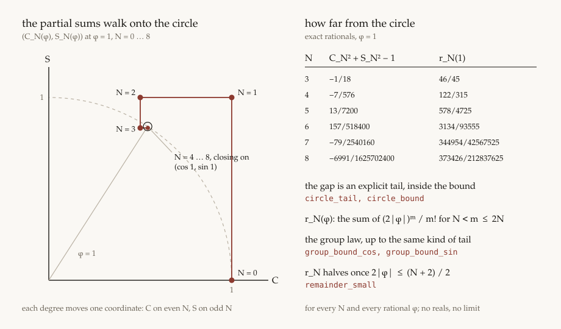

# Un universo quantistico minimo, e dove vive ogni sua identità

Nota sul kernel `universe`. I nomi in corpo di testo sono lemmi di Lean 4.34.1, nel pacchetto `Universe`, o righe di `python -m universe`. L'indice riga per riga è il README. Qui si registra come le identità si ripartiscono: quali valgono senza regole, quali chiedono il cerchio e l'asse, quali la sfera delle ampiezze, e quali numeri razionali ne escono.

## 1. La tripla

Un universo è `(X, Φ, Obs)`. `X` è lo spazio degli stati e la composizione. `Φ` è la legge. `Obs` è ciò che un osservatore interno estrae. Due descrizioni sono lo stesso universo quando un isomorfismo commuta con `Φ` e con `Obs`.

Le due parentesizzazioni di tre qubit sono quell'isomorfismo. `Universe.Composition.tensor_assoc` identifica le ampiezze di `((|ψ⟩ ⊗ |φ⟩) ⊗ |χ⟩)` e di `(|ψ⟩ ⊗ (|φ⟩ ⊗ |χ⟩))`, con indice `4·i + 2·j + k`. `tensor_assoc_ui` porta `(U ⊗ I ⊗ I)` sul primo fattore. `tensor_assoc_obs` identifica il modulo quadro di ogni cella. Associazione e poi `U` sul primo fattore è la stessa lista di `U` e poi associazione. L'argomento, con la tabella delle otto celle, è `researches/associazione.md`.


Il mondo è un qubit, e poi quanti qubit si vuole. `X = ℂ²`. L'Hamiltoniana è `H = n·σ`, con

```
Y = [[0, −i], [i, 0]].
```

Sul quoziente `c² + s² = 1` e `|n| = 1` la forma chiusa dell'evoluzione è

```
U = c I − i s H.
```

`c` e `s` sono indeterminate del quoziente del cerchio. Il collasso della serie che autorizza quella scrittura è `Universe.Series.expCoeff`, istanziato su `H` da `Universe.Qubit.expCoeff_hamiltonian`: `H² = I` nel quoziente, quindi i coefficienti di `φⁿ/n!` in `exp(−iφ H)` sono quelli di `cos φ · I + (−i sin φ) · H`. Non è un limite: le due serie formali coincidono grado per grado. `Obs` è la misura proiettiva nella base computazionale, e la probabilità di un'ampiezza è il suo modulo quadro. La sezione 7 ricava quegli stessi pesi dall'interno: sono la diagonale di un apparato (`Universe.Observer.pointer_born`).

## 2. L'anello e i livelli di uguaglianza

Lo scalare è `ℚ(i)`, `Universe.Ring`. Un polinomio è una lista di termini

```
coefficiente · c^c s^s nx^nx ny^ny nz^nz ar^ar ai^ai br^br bi^bi a2r^a2r a2i^a2i a3r^a3r a3i^a3i c2^c2 s2^s2 mx^mx my^my mz^mz.
```

Il monomio ha diciotto esponenti con nome: `c s nx ny nz` per la legge, otto per le ampiezze di due qubit, `c2 s2` per un secondo passo di tempo, `mx my mz` per un secondo asse. Perché restano campi con nome e non un parametro è `researches/monomio.md`; da `n` qubit in su il monomio non cresce, perché i teoremi quantificano su ogni stato (sezione 6).

Due generatori del quoziente, con cofattori nell'anello libero:

```
gC = c² + s² − 1,
gN = nx² + ny² + nz² − 1.
```

`Universe.Quotient.reduce` sbuccia solo `c²` e `nx²`, in quest'ordine sulle variabili e con `nx` prima di `ny` e `nz` nel secondo quadrato:

```
c²  = (1 − s²) + gC,
nx² = (1 − ny² − nz²) + gN.
```

`reduce_sound` dice che, per ogni polinomio e ogni monomio, i coefficienti di `p` coincidono con quelli di `resto + f·gC + g·gN`. Se il resto ha tutti i coefficienti zero, `p` sta nell'ideale `(gC, gN)`, e il testimone esibisce l'appartenenza. `Universe.Dynamics.reduce_complete` è il converso per questo `reduce`: se `p` sta nell'ideale, ogni coefficiente del resto è zero. L'enunciato è su `coeffOf`, perché una lista non vuota può cancellarsi; i cofattori non sono unici.

`gC` è monico di grado 2 in `c`, `gN` in `nx`, e le due variabili sono disgiunte. `reduceC` sbuccia solo `c²`. Se `f · gC` non ha grado `≥ 2` in `c`, la discesa sulle fette `sliceC` a partire da `cBound` annulla ogni coefficiente di `f`. Lo stesso vale per `gN` e `sliceNx`. Un resto `normal` nell'ideale si divide in `c`, e le due discese lo azzerano. `mul_gC_low` e `mul_gN_low` stanno in `Dynamics`, perché una fetta a coefficienti zero può non essere la lista vuota; il motore delle fette sta in `Quotient`, e `reduce_gC_rem` e `reduce_gN_rem` restano il calcolo diretto. L'argomento per esteso è `researches/divisione-monica.md`.

Gli altri generatori non entrano in `reduce`. Ciascuno ha un predicato suo, con cofattori espliciti:

```
gA  = ar² + ai² + br² + bi² − 1      la sfera delle ampiezze, inIdeal3
gC2 = c2² + s2² − 1                  il cerchio del secondo passo, inIdealCircle
gM  = mx² + my² + mz² − 1            il secondo asse, inIdeal4
```

`inIdeal` è l'ideale `(gC, gN)`, `inIdealN` quello del solo `gN`. Il nucleo ha così sei livelli di uguaglianza, e ogni identità della nota ne abita uno:

| livello             | che cosa ci vive                                                                                                     |
| ------------------- | -------------------------------------------------------------------------------------------------------------------- |
| anello libero       | `H† = H`, il modulo reale, il proiettore, i due assi, `CNOT`, la decoerenza, l'accordo degli osservatori, il fan-out |
| `(gN)`              | la legge di gruppo sullo stesso asse                                                                                 |
| `(gC, gN)`          | unitarietà, norma, energia, il no-signalling, il cambio di base sulla legge simbolica                                |
| `(gC, gN, gA)`      | la somma delle probabilità sullo stato generico, la purezza dopo `CNOT`                                              |
| `(gC, gC2)`         | l'angolo composto resta sul cerchio                                                                                  |
| `(gC, gN, gC2, gM)` | il prodotto di due rotazioni su assi diversi resta unitario                                                          |

Sotto i livelli algebrici ci sono i razionali. In `Universe.Evaluation`, `evalAt`, `evalAt2` ed `evalAt3` valutano un polinomio in un punto di `ℚ`, e sono omomorfismi (`eval_polySame`, `eval_pmul`, `eval_conj`). Il punto `c = 3/5`, `s = 4/5`, `n = eₓ` rende ogni previsione una frazione esatta; le somme parziali della sezione 4 legano `c` e `s` a un angolo razionale.

## 3. La legge

Sul libero, `hamiltonian_dagger` è `H† = H`. Nel quoziente, `hamiltonian_sq` dà la diagonale di `H² − I` uguale a `gN`, con cofattore la costante `1`, e il fuori diagonale a coefficienti zero. `hamiltonian_cube` e `hamiltonian_fourth` seguono da `H² = I` per moltiplicazione delle matrici quoziente.

Le identità di conservazione hanno gli stessi cofattori. Sia

```
δ = gC + s² gN.
```

Allora `evolution_unitary`, `evolution_unitary_rev` e `evolution_det` dicono che `U†U − I`, `UU† − I` e `det U − 1` sono `δ` sulle entrate diagonali, nel senso dell'ideale `(gC, gN)`. Per ogni coppia di ampiezze, `evolution_norm` mette il sandwich `ψ†(U†U)ψ − ‖ψ‖²` nello stesso ideale. `literal_sandwich` dice che, per ogni matrice e ogni coppia di ampiezze, il modulo letterale `|γ₀|² + |γ₁|²` con `γ = Uψ` ha gli stessi coefficienti di `ψ†(U†U)ψ`. `born_norm` identifica `‖ψ‖²` nell'ordine `z · conj(z)` con `normAmp`. `literal_evolution_norm` trasporta l'ideale sul polinomio `‖Uψ‖² − ‖ψ‖²` che il certificato riduce.

`Φ|0⟩` è la prima colonna di `U`, `(c − i s nz, s ny − i s nx)`. `ground_prob_sum` mette `P(0) + P(1) − 1` di quello stato in `(gC, gN)`, con gli stessi cofattori di `δ`: la sfera qui non compare, perché la norma di `|0⟩` è già `1` nel libero.

`U` commuta con `H` nel libero: `UH` e `HU` sono entrambi `c H − i s H²` (`Universe.Symmetry.evolution_commutes_hamiltonian`). Quindi `U†HU = U†UH`, ed `energy_conserved` mette `⟨Uψ|H|Uψ⟩ − ⟨ψ|H|ψ⟩` in `(gC, gN)` per ogni coppia di ampiezze, con gli stessi cofattori di `δ`. `point_energy_x` e `point_energy_z` valutano `⟨0|H|0⟩` nel punto: `0` lungo x, `1` lungo z, prima e dopo `Φ`.

Il principio d'identità ha un caso base. Per ogni matrice `V` con `V†V = I` nel libero, `conj_evolution` dà `V(Uψ) = (VUV†)(Vψ)` e `conj_born` dà ai pesi di `Vψ` nella base `V|k⟩` i valori di `ψ`: la descrizione ruotata evolve e osserva come l'originale. `conj_inverse` ricava `VV† = I`. Con `V†V = I` modulo `(gC, gN)` gli stessi enunciati valgono nell'ideale (`conj_evolution_rel`, `conj_born_rel`), e si applicano alla legge simbolica, `V = U` (`conj_evolution_law`, `conj_born_law`). Nel punto, `V(U|0⟩) = −7/25 |0⟩ − 24/25 i |1⟩` (`point_conj_evolution`, `point_conj_born`).

## 4. Il tempo

Due passi della legge sono un passo. `evolution_compose` mette `U(c₁, s₁) U(c₂, s₂) − U(c₁c₂ − s₁s₂, s₁c₂ + c₁s₂)` nell'ideale del solo `gN` (`inIdealN`): la legge di gruppo usa `H² = I` e non il cerchio. Restare sul cerchio lo usa: `compose_circle` mette `c² + s² − 1` in `(gC, gC2)` con cofattori `c₂² + s₂²` e `1` (`inIdealCircle`). Il punto `(3/5, 4/5)` due volte è `(−7/25, 24/25)`, e `U²|0⟩ = −7/25 |0⟩ − 24/25 i |1⟩`: `evalAt2`, che legge anche `c2 s2` e coincide con `evalAt` dove quei due esponenti sono nulli (`evalAt2_agrees`), dà lo stesso valore in Lean (`point_compose`).


Due assi. `pauli_product` dà `(n·σ)(m·σ) = (n·m) I + i (n×m)·σ` nel libero, per polinomi qualsiasi. Con `evolutionM`, il passo sull'asse `m`, `evolution_compose_axes` dà `U(c₁, s₁, n) U(c₂, s₂, m) = a I − i (b·σ)` nel libero, con `a = c₁c₂ − s₁s₂ (n·m)` e `b = s₁c₂ n + c₁s₂ m + s₁s₂ (n×m)`: la legge sullo stesso asse chiedeva `gN`, questa nessuna regola. `compose_axes_same` ritrova quella legge con `m = n`, modulo `gN`. `axes_norm_free` è l'identità dei quattro quadrati, `a² + |b|² = (c₁² + s₁²|n|²)(c₂² + s₂²|m|²)`, e `compose_axes_norm` mette `a² + |b|² − 1` in `(gC, gN, gC2, gM)` (`inIdeal4`) con cofattori `R₂`, `s₁² R₂`, `1`, `s₂²`, dove `R₂ = c₂² + s₂²|m|²`. `evalAt3` legge anche `mx my mz` e coincide con `evalAt2` dove sono nulli (`evalAt3_agrees`). In `n = eₓ`, `m = e_z`, `(3/5, 4/5)` due volte, `a = 9/25` e `b = (12/25, −16/25, 12/25)` (`point_axes`). `rotations_noncommute`: `UₙUₘ|0⟩` e `UₘUₙ|0⟩` hanno la stessa ampiezza su `|0⟩`, `9/25 − 12/25 i`, e su `|1⟩` `−16/25 − 12/25 i` e `16/25 − 12/25 i`; i pesi sono `9/25` e `16/25` in entrambi gli ordini.


Il tempo continuo, fin dove arriva senza i reali. Senza Mathlib non c'è un numero reale in cui mettere `cos φ`. `Universe.Angle` lega `c` e `s` a un angolo razionale `φ` con le somme parziali `C_N(φ) = Σ_{k≤N} cosCoeff k · φᵏ/k!` e `S_N(φ)`, razionali esatti, sui coefficienti di `Universe.Series`. I termini hanno una derivata discreta, `(m+1) c_{m+1} = −x s_m` e `(m+1) s_{m+1} = x c_m` (`cTerm_deriv`, `sTerm_deriv`), e da questa la legge di addizione vale grado per grado, per ogni `m`, `x`, `y` (`angle_add_cos`, `angle_add_sin`); `xᵐ/m!` ha la stessa legge con la stessa prova (`exp_add`). Con `y = −x` i gradi da `1` a `N` si cancellano in `C_N² + S_N²`: `C_N² + S_N² − 1` è una coda esplicita (`circle_tail`), e `circle_bound` la limita con `r_N(φ) = Σ_{N<m≤2N} (2|φ|)ᵐ/m!`. Una sola stima di banda, `highBand_abs_le`, dà anche la legge di gruppo: `C_N(x + y)` dista da `C_N(x) C_N(y) − S_N(x) S_N(y)` al più `Σ_{N<m≤2N} (|x| + |y|)ᵐ/m!` (`group_bound_cos`, `group_bound_sin`): i gradi `≤ N` sono `C_N(x + y)` e `S_N(x + y)`, e resta la coda esplicita (`group_cos_tail`, `group_sin_tail`). In `N = 4`, `x = y = 1/2` gli scarti sono `53/49152` e `−71/9216`, sotto `401/40320` (`group_half`). Quando `2|φ| ≤ (N + 2)/2` i termini di `r_N` si dimezzano, e `remainder_small` dà `r_N(φ) ≤ 2 (2|φ|)^{N+1}/(N+1)!`; in `N = 4`, `φ = 1/2`, `401/40320 ≤ 1/60` (`remainder_half`).

Il qubit all'angolo `φ`. In `(c, s) = (C_N(φ), S_N(φ))` lungo `eₓ`, `U|0⟩` ha ampiezze `C_N` e `−i S_N` e pesi `C_N²`, `S_N²`, la cui somma dista da `1` al più `r_N` (`angle_born`). I pesi sono i quadrati per ogni `(c, s)`: `eval_columnBorn` porta il modulo sul valore, ed `eval_bracket_axis_x` con `eval_bracket_axis_x_1` legge le due ampiezze (`born_axis_x`). In `φ = 1/2`, `N = 4` le ampiezze sono `337/384` e `−23/48 i` (`angle_half`); in `φ = 1`, `N = 8`, `C₈² + S₈² − 1 = −6991/1625702400` e `r₈ = 373426/212837625` (`circle_eight`). I punti concreti si chiudono con `decide_cbv`, perché il `decide` del kernel non apre l'aritmetica di `Rat`. Non è un limite: `cos φ` non c'è, ci sono le somme e la stima, per ogni `N`.



## 5. L'osservazione

Tre fatti sono liberi, prima di ogni quoziente. `modulus_squares` e `modulus_imag_zero`: per ogni polinomio, `z · conj(z)` ha i coefficienti di `re(z)² + im(z)²`, e ogni coefficiente ha parte immaginaria zero. `columnBorn_real` è lo stesso enunciato per ogni peso di Born, `ground_prob_real` il caso di `Φ|0⟩`. `projector_born`: `Π₀ = diag(1, 0)` e `⟨ψ|Π₀|ψ⟩ = |α|²` per ogni coppia di ampiezze, con gli stessi coefficienti.

La sfera entra su uno stato generico `(ar + i ai, br + i bi)`. `sphere_prob_sum` mette `ψ†(U†U)ψ − 1` in `(gC, gN, gA)`, con tre cofattori (`inIdeal3`). `literal_sphere` trasporta gli stessi tre cofattori sul modulo letterale `‖Uψ‖² − 1`, perché `literal_sandwich` dà ai due polinomi gli stessi coefficienti. Il certificato Python esibisce quell'appartenenza con `certify_extra`, e `gA` resta generatore accanto alle due regole dell'anello: senza `gA` quel resto non è zero.

La ripartizione è questa. La conservazione della norma, per ampiezze arbitrarie, vive in `(gC, gN)`. La somma delle probabilità sullo stato generico vive in `(gC, gN, gA)`. La somma sullo stato fondamentale evoluto torna a `δ`, perché la sua norma è già `1` nel libero.

Gli assi. `keepX` e `keepZ` sono omomorfismi di valutazione sui monomi. `keepX` tiene un monomio quando `ny = nz = 0` e azzera l'esponente di `nx`; `keepZ` tiene un monomio quando `nx = ny = 0` e azzera l'esponente di `nz`; un monomio con un altro esponente di asse positivo viene scartato. `keepX_mul` e `keepZ_mul` commutano con il prodotto di monomi, `spec_append` con la somma. `specX_conj`, `specZ_conj`, `specX_pmul` e `specZ_pmul` fanno di `spec` un omomorfismo d'anello, nel senso di `polySame` sul prodotto. `spec_columnBorn` ne deduce che specializzare un peso di Born è il peso di Born dell'ampiezza già specializzata.

Lungo x, `axis_x_prob0` è `|c|² − (1 − s²) = gC` sull'ampiezza specializzata, e `axis_x_born0` è lo stesso enunciato su `spec keepX groundP0`. `axis_x_prob1` e `axis_x_born1` danno `|-i s|² = s²` a partire da `groundP1`. `axis_x_gn` azzera i coefficienti di `gN`. Lungo z, `axis_z_prob1` e `axis_z_born1` dicono che la seconda ampiezza e il suo peso sono il polinomio zero: `|0⟩` è autostato. `axis_z_prob0` e `axis_z_born0` sono `|c − i s|² − 1 = gC`, e `axis_z_gn` azzera i coefficienti di `gN` anche lungo z. Il certificato Python sostituisce `nx`, `ny`, `nz` nei pesi di Born già calcolati per `Φ|0⟩` e confronta le forme ridotte.

Il punto razionale. Per ogni `c` e `s`, `eval_prob_axis_x` valuta i pesi specializzati lungo `eₓ` in `c²` e `s²`; `point_prob0` e `point_prob1` sono il caso `c = 3/5`, `s = 4/5`, con `9/25` e `16/25`. `point_gC` e `point_gN` sono i due vincoli in `ℚ`, e `point_unitary` valuta `δ` in quel punto e ottiene zero. La chiusura è `ext`, poi `simp`, poi `grind` sui razionali di Gauss. Il certificato Python moltiplica la matrice numerica e legge gli stessi valori sui moduli della prima colonna.

| lettura                  | P(0)   | P(1)  |
| ------------------------ | ------ | ----- |
| lungo x                  | 1 − s² | s²    |
| lungo z                  | 1      | 0     |
| c = 3/5, s = 4/5, n = eₓ | 9/25   | 16/25 |


## 6. Composizione

L'indice di `|i⟩ ⊗ |k⟩` è `right · i + k`, `Universe.Composition.tensorIndex`, il passo binario di `Universe.Ontology.tensorIndexAssoc`. `ground_tensor`: `|0⟩ ⊗ |0⟩` ha ampiezza `1` nella cella `0` e il polinomio zero nelle altre tre.

Per ogni matrice 2×2 e ogni coppia di ampiezze, `kronecker_ui_gen` è

```
(U ⊗ I)(|ψ⟩ ⊗ |φ⟩) = (U|ψ⟩) ⊗ |φ⟩.
```

È un'uguaglianza di liste: la distributività a sinistra di `pmul`. `kronecker_ui` è il caso `|φ⟩ = |0⟩`. `marginal_left_gen` dice che il marginale sinistro ha i coefficienti di `‖φ‖² · Pᵢ(U|ψ⟩)`; `normPair_ket0` dice che, per `|φ⟩ = |0⟩`, `‖φ‖²` è la costante `1` nel libero, e `marginal_ui_from_gen` ritrova `marginal_ui`. `kronecker_iu_gen` scambia i fattori: il prodotto sta nel fattore destro, quindi l'uguaglianza è `quadSame`, gli stessi coefficienti, e `marginal_right_gen` è `‖ψ‖² · Pᵢ(U|φ⟩)`; con il fattore fermo uguale a `|0⟩` si ritrova `marginal_iu`. Sul fattore generico, `marginal_left_sphere` e `marginal_right_sphere` tolgono il fattore `‖φ‖²` con cofattore esplicito `gA`.

Su tre qubit, `tensorIndex_assoc_qubit` è `tensorIndexAssoc` con dimensioni `2` e `2`. `tensor_assoc` è l'uguaglianza di liste fra le due parentesizzazioni: la cella `(i, j, k)` vale `ψᵢ φⱼ χₖ` in entrambe. `assoc_row` fa attraversare a una riga di `U` i due prodotti, con `pmul_assoc` e `pmul_append_left`. `applyUII` agisce sul bit alto: la prima riga di `U` sulle celle `0`–`3`, la seconda sulle celle `4`–`7`. `tensor_assoc_ui` è `(U ⊗ I ⊗ I)((ψ ⊗ φ) ⊗ χ) = ((Uψ) ⊗ φ) ⊗ χ`, e `tensor_assoc_ui_right` è la stessa azione sulla parentesizzazione destra. `bornOct` applica `columnBorn` a ogni cella, e `tensor_assoc_obs` identifica i due pesi.

Il certificato Python confronta i polinomi ridotti nel caso `|φ⟩ = |0⟩`, anche quando l'altro fattore è lo stato generico. La riga di associatività usa due anelli: gli indici stanno su `(i, j, k, nb, nc)`, ampiezze e `(U ⊗ I ⊗ I)` su `(u00, u01, u10, u11, a0, a1, b0, b1, c0, c1)`.

Tre copie di `Φ|0⟩` (`threeCopies`), valutate in `c = 3/5`, `s = 4/5`, `n = eₓ`, riempiono le otto celle: il peso è `9/25` per ogni bit `0` e `16/25` per ogni bit `1` (`point_cells`). Le due parentesizzazioni danno gli stessi pesi e la somma è `1`.


| cella | bit | peso       |
| ----- | --- | ---------- |
| 0     | 000 | 729/15625  |
| 1     | 001 | 1296/15625 |
| 2     | 010 | 1296/15625 |
| 3     | 011 | 2304/15625 |
| 4     | 100 | 1296/15625 |
| 5     | 101 | 2304/15625 |
| 6     | 110 | 2304/15625 |
| 7     | 111 | 4096/15625 |

Ogni numero di qubit. `Universe.Qubits` rappresenta uno stato di `n` qubit come un albero binario perfetto, `QState n`: `node l r` divide sul primo qubit, e l'ordine delle `2ⁿ` foglie è quello di `Quad` e di `Oct`. `applyAt k U` agisce sul qubit `k` mescolando le foglie che differiscono solo in quel bit; ogni prova è un'induzione sull'albero, e `Mono` non cresce. `norm_applyAt` mette `‖applyAt k U v‖² − ‖v‖²` in `(gC, gN)`: sul qubit alto è `literal_evolution_norm` foglia per foglia, più in basso la somma delle due differenze dei figli. `no_signalling_at` dice lo stesso del marginale di ogni qubit `a ≠ k`. `applyAt_comm` fa commutare due porte su qubit diversi, nel libero, foglia per foglia (`qstateSame`). `reduceAt` è la traccia parziale su un qubit; `reduceAt_diag` ne dà la diagonale, `marginalAt`, e `reduceAt_product` il valore `‖resto‖² |ψ⟩⟨ψ|` su un prodotto. Il fan-out, un `CNOT` dal qubit `0` verso ogni altro, dà `α|0…0⟩ + β|1…1⟩` (`fanout_ghz`); `fanout_agree` azzera il peso delle celle in cui due qubit differiscono, e `fanout_decoherence` rende diagonale il sistema per `n ≥ 2`. Sotto `ofQuad` e `ofOct`, `applyAt` è `applyUI`, `applyIU`, `applyUII`, `applyIUI`, `applyIIU`: `reduce_product`, `no_signalling_any_0`, `no_signalling_any_1`, `no_signalling_wigner` e `no_signalling_friend` ne sono corollari. Il certificato Python controlla gli stessi fatti su stati generici fino a quattro o cinque qubit (`universe/qubits.py`).


## 7. L'osservatore

`Obs` era un assioma. Qui diventa la diagonale di un sottosistema. Il modulo è `Universe.Observer`; ogni enunciato vale per ogni coppia di ampiezze, nell'anello libero, salvo dove è detto.

`applyCNOT` scambia le celle `|10⟩` e `|11⟩`. `cnot_involutive` è `CNOT² = I`, come uguaglianza di liste. `cnot_norm` conserva la somma dei quattro pesi di Born. `cnot_ket0` è

```
CNOT(|ψ⟩ ⊗ |0⟩) = α|00⟩ + β|11⟩.
```

`quadDet` è `a₀a₃ − a₁a₂`. `product_det` lo annulla su ogni prodotto: è la commutatività e l'associatività di `pmul` nei coefficienti. `entangled_det` dà `α β` dopo `CNOT`. Nel punto `c = 3/5`, `s = 4/5`, `n = eₓ`, `point_bell` valuta le quattro celle in `3/5`, `0`, `0`, `−4/5 i`, `point_entangled` dà `−12/25 i`, e `point_not_product` dice che nessuna coppia di vettori di `ℚ(i)` ha quel tensore.


L'interazione non è scritta a mano. `Universe.Interaction` prende il generatore `G = |1⟩⟨1| ⊗ (n·σ)`: `G² = |1⟩⟨1| ⊗ I` modulo `gN` e `G³ = G` (`generator_cube`). `Universe.Series.expCoeff_idem` è il secondo collasso della serie: se `a³ = a`, i coefficienti di `exp(−iφ a)` sono quelli di `(1 − a²) + cos φ · a² − i sin φ · a`. Su `G` quella forma è `|0⟩⟨0| ⊗ I + |1⟩⟨1| ⊗ U` (`controlled_from_hamiltonian`). Nel punto `c = 0`, `s = 1`, `n = eₓ` vale `U = −i X`, e `cnot_point` identifica l'evoluzione controllata con `CNOT` seguito dalla fase `−i` sul `|1⟩` del controllo. `cnot_point_born` mostra che la fase esce da ogni peso di Born: i teoremi che seguono valgono per l'interazione dinamica. Con `α = 3/5`, `β = −4/5 i` lo stato è `3/5|00⟩ − 4/5|11⟩`, con pesi `9/25` e `16/25` (`point_cnot_sample`, valutato attraverso `eval_keepFlip`).

`reduceLeft` è la traccia parziale sull'apparato, `reduceRight` sul sistema. `reduceLeft_diag` dice che la diagonale è `marginalLeft`, per definizione. `reduce_product` dà `‖φ‖² |ψ⟩⟨ψ|` su un prodotto: senza interazione il sistema resta puro. `coherence_before` dà `α β̄` fuori diagonale prima di `CNOT`. `decoherence` dice che dopo `CNOT` i due termini fuori diagonale sono il polinomio zero e la diagonale è `bornPair ψ`. `pointer_born` è lo stesso fatto letto sull'apparato, per `Φ|ψ⟩`: la diagonale dello stato ridotto dell'apparato è `bornPair (Φ|ψ⟩)`. È l'enunciato che prende il posto dell'assioma. Non usa né `δ` né `gA`: i pesi che l'apparato legge sono quelli di `Φ|ψ⟩`, normalizzati o no, e la loro somma è il fatto della sezione 5.

`purity` è `Tr(ρ²)`. `purity_before` dà `‖ψ‖⁴` su `|ψ⟩⟨ψ|`. `purity_after` dà `|α|⁴ + |β|⁴` dopo `CNOT`. `purity_sphere` mette `1 − purezza − 2|α|²|β|²` in `(gC, gN, gA)`, sullo stato generico, con il solo cofattore di `gA`. `point_purity` vale `337/625` nel punto, minore di `1`: lo stato ridotto è misto.


Con l'evoluzione controllata come accoppiamento, lo stato è `α|0⟩|0⟩ + β|1⟩ U|0⟩`. `partial_coherence` dice che la coerenza del sistema è `α β̄ · conj(⟨0|U|0⟩)` nel libero, con `⟨0|U|0⟩ = c − i s nz`; `partial_diagonal` che la diagonale resta la coppia di Born modulo `(gC, gN)`. Lungo x, per `ψ = Φ|0⟩` nel punto, `partial_reading` dà coerenza `(12/25 i)·c` e purezza `337/625 + (288/625)·c²`: `1`, `11017/15625` e `337/625` in `c = 1`, `3/5`, `0` (`point_partial_idle`, `point_partial_mid`, `point_partial_flip`). La misura ha gradi; quella perfetta è un punto.


Leggere il puntatore. `condition k` proietta l'apparato su `|k⟩` e restituisce lo stato non normalizzato del sistema; `condition_norm` dà la sua norma per ogni `Quad`. `luders` dice che dopo `CNOT` su `|ψ⟩ ⊗ |0⟩` le due letture lasciano `(α, 0)` e `(0, β)`, con norme `bornPair ψ`: la regola di aggiornamento è un teorema. `repeatable` accoppia un secondo apparato allo stato condizionato: legge lo stesso esito con lo stesso peso, e l'altro con peso zero. `point_luders` e `point_repeatable` sono i valori nel punto, `3/5|0⟩` e `−4/5 i|1⟩` con pesi `9/25` e `16/25`.

Due apparati. `cnot01` agisce dal bit alto al bit medio, `cnot02` dal bit alto al bit basso. `two_pointers` dà `α|000⟩ + β|111⟩` su `|ψ⟩ ⊗ |0⟩ ⊗ |0⟩`. `observers_agree` dice che i pesi delle celle 1–6, dove i due puntatori differiscono, sono il polinomio zero. `order_irrelevant` scambia l'ordine dei due `CNOT`. Le versioni `_right` passano per `tensor_assoc`. Il fan-out della sezione 6 è lo stesso fatto per `n` apparati.


L'amico di Wigner. `cnot12` agisce dal bit medio al bit basso: Wigner legge l'amico. `chain_pointers` e `chain_is_fanout` danno, su `|ψ⟩ ⊗ |0⟩ ⊗ |0⟩`, lo stesso stato di `two_pointers`; `chain_agree` è l'accordo. `reduceSystem` è la traccia parziale su amico e Wigner, e `reduceSystem_product` la riporta a `|ψ⟩⟨ψ|` su un prodotto. `friend_undone`: `cnot01` due volte restituisce lo stato e la coerenza `α β̄`. `copy_irreversible`: dopo `cnot12` lo stesso `cnot01` lascia `α|000⟩ + β|101⟩`, i due termini fuori diagonale sono il polinomio zero e la diagonale è `bornPair ψ`; `wigner_keeps_record` dice che Wigner legge ancora quella coppia. Nel punto, `point_undone` dà coerenza `12/25 i` e purezza `1`, `point_copied` coerenza `0`, purezza `337/625` e pesi `9/25`, `16/25`. Che cosa questo dica sulla misura è `researches/misura.md`.


Nessun segnale. Un unitario locale sull'apparato non cambia i pesi del sistema, per ogni stato di due qubit. `no_signalling_any_0` e `no_signalling_any_1` confrontano `marginalLeft (applyIU evolution v)` con `marginalLeft v` per ogni `v : Quad`: `I ⊗ U` agisce su ciascun blocco `(a₀, a₁)` e `(a₂, a₃)` come `U` su un qubit, quindi ogni componente della differenza è `‖Uγ‖² − ‖γ‖²`, che `literal_evolution_norm` mette in `(gC, gN)`. `no_signalling_gen_0` e `no_signalling_gen_1` sono il caso `genericQuad`, le cui quattro celle usano gli otto esponenti delle ampiezze di `Mono`; `no_signalling_0` e `no_signalling_1` sono il caso `CNOT(|ψ⟩ ⊗ |0⟩)`. `no_signalling_wigner` e `no_signalling_friend` valgono per ogni `v : Oct`, e `no_signalling_at` per ogni `n`. Il certificato Python fa lo stesso conto su uno stato di due qubit generico, otto reali di ampiezza più `c`, `s`, `n`.


La ripartizione è questa. Nel libero stanno `CNOT`, il determinante, la decoerenza, `pointer_born`, la regola di Lüders, l'accordo degli apparati, la catena di Wigner e il fan-out. In `(gC, gN)` stanno il no-signalling e la diagonale della misura parziale, con i cofattori di `δ`. `purity_sphere` usa `gA`. `reduceLeft_diag`, `reduce_product`, `purity_before` e `purity_sphere` sono solo in Lean.

Questo non dice quale esito avviene, né perché la base sia quella computazionale: la base è scelta da `CNOT`. Dice che, dentro il modello, i pesi di Born sono ciò che un sottosistema registra, che due registrazioni coincidono, e che un unitario locale sull'apparato non li cambia. L'argomento, i vicoli ciechi e i candidati per il passo successivo sono in [`researches/osservatore.md`](../researches/osservatore.md).

## 8. Due nuclei, un insieme di numeri

Il certificato eseguibile stampa 82 righe, ciascuna `[dimostrato]`. Una riga algebrica è dimostrata quando il resto è zero e l'espansione libera dei cofattori ridà il polinomio; le righe del tempo continuo sono uguaglianze e disuguaglianze di razionali. Il testo formale non è un'estrazione del testo Python, né il contrario, e dove calcolano polinomi diversi la nota lo dice. I due nuclei si incontrano in tre punti, ciascuno sorvegliato da un test:

- i nomi: ogni riga del certificato è mappata in `universe/lean_map.py` su teoremi di Lean che esistono (`tests/test_lean_map.py`), e ogni nome `Universe.*` citato da Python o dai documenti è dichiarato in Lean (`tests/test_lean_citations.py`);
- i conteggi: ogni documento che cita il numero di righe del certificato dice il numero giusto (`tests/test_doc_counts.py`);
- i numeri: `lake exe points` stampa `points.txt` da `Universe.Points.table`, dove ogni voce è un `def` il cui corpo è il membro sinistro di un teorema di punto, legato a esso da `example : voce = valore := teorema`, così che il numero stampato è il numero dimostrato. `universe/points.py` costruisce la stessa tabella dai valori che il certificato calcola per le sue righe, e `tests/test_points.py` confronta le due in frazioni esatte. Ogni risultato razionale che il certificato stampa è una chiave; solo gli ingressi `1/2` e `4/5` non lo sono.

I due nuclei non si chiamano mai: si incontrano solo nei nomi e nei numeri.

## 9. Fuori da questa nota

Fuori dalla 1.0 (`plans/roadmap.md`): un secondo universo fisico, la meccanica classica, una libreria di basi generali, Mathlib, e la verifica del sorgente Python dentro Lean. Il tempo continuo arriva fin dove arrivano i razionali: le somme parziali e la loro stima, non `cos φ` come numero reale. I limiti del nucleo (l'esito singolo, l'origine della regola di Born, lo spazio, i campi, la gravità) sono in `researches/misura.md`, `researches/born.md` e `researches/distanza.md`.
