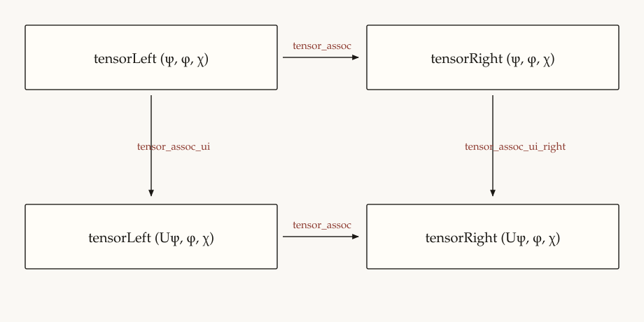
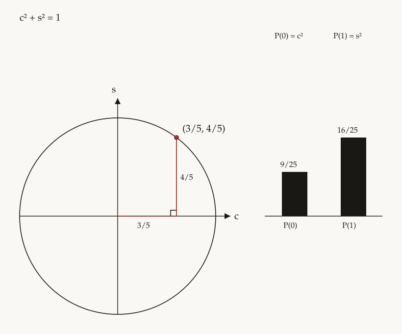
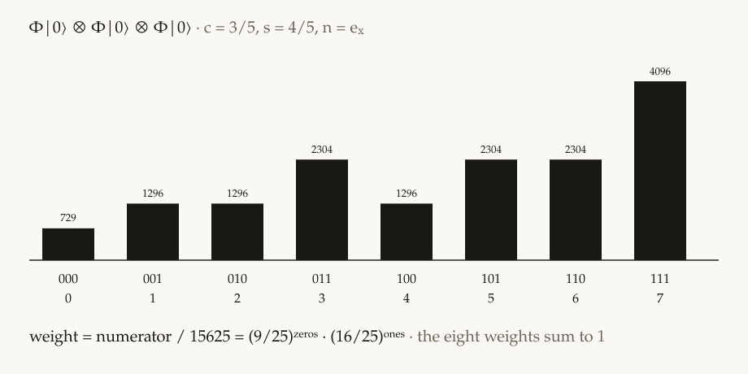

# Un qubit, tre livelli di uguaglianza

Nota sul primo mondo del kernel `universe`. I nomi in corpo di testo sono lemmi di Lean 4.34.1, nel pacchetto `Universe`, o certificati di `python -m universe`. L'indice riga per riga è il README. Qui si registra come le identità si ripartiscono.

## 1. La tripla

Un universo è `(X, Φ, Obs)`. `X` è lo spazio degli stati e la composizione. `Φ` è la legge. `Obs` è ciò che un osservatore interno estrae. Due descrizioni sono lo stesso universo quando un isomorfismo commuta con `Φ` e con `Obs`.

Le due parentesizzazioni di tre qubit sono quell'isomorfismo. `Universe.Composition.tensor_assoc` identifica le ampiezze di `((|ψ⟩ ⊗ |φ⟩) ⊗ |χ⟩)` e di `(|ψ⟩ ⊗ (|φ⟩ ⊗ |χ⟩))`, con indice `4·i + 2·j + k`. `tensor_assoc_ui` porta `(U ⊗ I ⊗ I)` sul primo fattore. `tensor_assoc_obs` identifica il modulo quadro di ogni cella. L'argomento, con la tabella delle otto celle, è `researches/associazione.md`.

Associazione e poi `U` sul primo fattore è la stessa lista di `U` e poi associazione.



`tensor_assoc_obs` identifica `z · conj(z)` su ogni cella dei due stati prima di `U`. I due stati dopo `U` hanno gli stessi pesi perché quegli stati sono uguali.

Il primo mondo è un qubit finito. `X = ℂ²`. L'Hamiltoniana è `H = n·σ`, con

```
Y = [[0, −i], [i, 0]].
```

La fase è `φ = ωt/2`. Sul quoziente `c² + s² = 1` e `|n| = 1` la forma chiusa è

```
U = c I − i s H.
```

`c` e `s` sono indeterminate del quoziente del cerchio. Il collasso della serie che autorizza quella scrittura è `Universe.Qubit.expCoeff_hamiltonian`: `H² = I` nel quoziente, quindi i coefficienti di `φⁿ/n!` in `exp(−iφ H)` sono quelli di `cos φ · I + (−i sin φ) · H`. `Obs` è la misura proiettiva nella base computazionale. La probabilità di un'ampiezza è il suo modulo quadro.

Il certificato eseguibile stampa 24 identità. Il testo formale non è un'estrazione del testo Python, né il contrario. I due testi si citano. Dove calcolano polinomi diversi, la nota lo dice.

## 2. L'anello

Lo scalare è `ℚ(i)`, `Universe.Ring`. Un polinomio è una lista di termini

```
coefficiente · c^c s^s nx^nx ny^ny nz^nz ar^ar ai^ai br^br bi^bi.
```

Due generatori del quoziente, con cofattori nell'anello libero:

```
gC = c² + s² − 1,
gN = nx² + ny² + nz² − 1.
```

`Universe.Quotient.reduce` sbuccia solo `c²` e `nx²`, in quest'ordine sulle variabili e con `nx` prima di `ny` e `nz` nel secondo quadrato:

```
c²  = (1 − s²) + gC,
nx² = (1 − ny² − nz²) + gN.
```

`reduce_sound` dice che, per ogni polinomio e ogni monomio, i coefficienti di `p` coincidono con quelli di `resto + f·gC + g·gN`. Se il resto ha tutti i coefficienti zero, `p` sta nell'ideale `(gC, gN)`. Il testimone esibisce l'appartenenza. `Universe.Dynamics.reduce_complete` è il converso per questo `reduce`: se `p` sta nell'ideale, ogni coefficiente del resto è zero. L'enunciato è su `coeffOf`: una lista non vuota può cancellarsi. I cofattori non sono unici.

`gC` è monico di grado 2 in `c`, `gN` in `nx`, e le due variabili sono disgiunte. `reduceC` sbuccia solo `c²`. Se `f · gC` non ha grado `≥ 2` in `c`, la discesa sulle fette `sliceC` a partire da `cBound` annulla ogni coefficiente di `f`. Lo stesso vale per `gN` e `sliceNx`. Un resto `normal` nell'ideale si divide in `c`, e le due discese lo azzerano. `mul_gC_low` e `mul_gN_low` stanno in `Dynamics`, perché una fetta a coefficienti zero può non essere la lista vuota. Il motore delle fette sta in `Quotient`. `reduce_gC_rem` e `reduce_gN_rem` restano il calcolo diretto. L'argomento per esteso è `researches/divisione-monica.md`. Il teorema è su `reduce` di Lean.

`gA = ar² + ai² + br² + bi² − 1` è definito nello stesso file. È il terzo generatore, la sfera delle ampiezze. `reduce` lo lascia dov'è.

## 3. La legge è un difetto

Sul libero, `hamiltonian_dagger` è `H† = H`. Nel quoziente, `hamiltonian_sq` dà la diagonale di `H² − I` uguale a `gN`, con cofattore la costante `1`, e il fuori diagonale a coefficienti zero. `hamiltonian_cube` e `hamiltonian_fourth` seguono da `H² = I` per moltiplicazione delle matrici quoziente. `expCoeff_hamiltonian` è l'istanza che scrive `U`.

Le quattro identità di conservazione hanno gli stessi cofattori. Sia

```
δ = gC + s² gN.
```

Allora `evolution_unitary`, `evolution_unitary_rev` e `evolution_det` dicono che `U†U − I`, `UU† − I` e `det U − 1` sono `δ` sulle entrate diagonali, nel senso dell'ideale `(gC, gN)`. Per ogni coppia di ampiezze, `evolution_norm` dice che il sandwich `ψ†(U†U)ψ − ‖ψ‖²` sta nello stesso ideale. `literal_sandwich` dice che, per ogni matrice e ogni coppia di ampiezze, il modulo letterale `|γ₀|² + |γ₁|²` con `γ = Uψ` ha gli stessi coefficienti di `ψ†(U†U)ψ`. `born_norm` identifica `‖ψ‖²` nell'ordine `z · conj(z)` con `normAmp`. `literal_evolution_norm` trasporta l'ideale sul polinomio `‖Uψ‖² − ‖ψ‖²` che il certificato riduce.

`Φ|0⟩` è la prima colonna di `U`, `(c − i s nz, s ny − i s nx)`. Le ampiezze di `|0⟩` sono `1` e `0`. `ground_prob_sum` mette `P(0) + P(1) − 1` di quello stato nello stesso ideale, con gli stessi cofattori di `δ`. La sfera qui non compare.

## 4. L'osservazione

Tre fatti sono liberi, prima di ogni quoziente.

`modulus_squares` e `modulus_imag_zero`: per ogni polinomio, `z · conj(z)` ha i coefficienti di `re(z)² + im(z)²`, e ogni coefficiente ha parte immaginaria zero. `columnBorn_real` è lo stesso enunciato per ogni peso di Born. `ground_prob_real` è il caso di `Φ|0⟩`.

`projector_born`: `Π₀ = diag(1, 0)` e `⟨ψ|Π₀|ψ⟩ = |α|²` per ogni coppia di ampiezze. Il sandwich del proiettore e il modulo di `α` hanno gli stessi coefficienti.

La sfera entra su uno stato generico `(ar + i ai, br + i bi)`. `sphere_prob_sum` mette `ψ†(U†U)ψ − 1` nell'ideale `(gC, gN, gA)`, con tre cofattori. Il predicato è `inIdeal3`. È nuovo: non estende `inIdeal` e non aggiunge una regola a `reduce`. `literal_sphere` trasporta gli stessi tre cofattori sul modulo letterale `‖Uψ‖² − 1`: `literal_sandwich` dà ai due polinomi gli stessi coefficienti. Il certificato Python esibisce quell'appartenenza con `certify_extra`, e `gA` resta generatore accanto alle due regole dell'anello. Senza `gA` quel resto non è zero.

La ripartizione è questa. La conservazione della norma, per ampiezze arbitrarie, vive in `(gC, gN)`. La somma delle probabilità sullo stato generico vive in `(gC, gN, gA)`. La somma sullo stato fondamentale evolve torna a `δ`, perché la sua norma è già `1` nel libero.

## 5. Assi e punto razionale

`keepX` e `keepZ` sono omomorfismi di valutazione sui monomi. `keepX` tiene un monomio quando `ny = nz = 0` e azzera l'esponente di `nx`. `keepZ` tiene un monomio quando `nx = ny = 0` e azzera l'esponente di `nz`. Un monomio con un altro esponente di asse positivo viene scartato. `keepX_mul` e `keepZ_mul` commutano con il prodotto di monomi. `spec_append` commuta con la somma per ogni scelta. `specX_conj`, `specZ_conj`, `specX_pmul` e `specZ_pmul` fanno di `spec` un omomorfismo d'anello, nel senso di `polySame` sul prodotto. `spec_columnBorn` ne deduce che specializzare un peso di Born è il peso di Born dell'ampiezza già specializzata.

Lungo x, `axis_x_prob0` è `|c|² − (1 − s²) = gC` sull'ampiezza specializzata, e `axis_x_born0` è lo stesso enunciato su `spec keepX groundP0`. `axis_x_prob1` e `axis_x_born1` danno `|-i s|² = s²` a partire da `groundP1`. `axis_x_gn` azzera i coefficienti di `gN`. Lungo z, `axis_z_prob1` e `axis_z_born1` dicono che la seconda ampiezza e il suo peso sono il polinomio zero, quindi `|0⟩` è autostato. `axis_z_prob0` e `axis_z_born0` sono `|c − i s|² − 1 = gC`. `axis_z_gn` azzera i coefficienti di `gN` anche lungo z.

Il certificato Python sostituisce `nx`, `ny`, `nz` nei pesi di Born già calcolati per `Φ|0⟩` e confronta le forme ridotte: lungo x, `P(0) = 1 − s²` e `P(1) = s²`; lungo z, `P(0) = 1` e `P(1) = 0`. Quel polinomio è `spec` di `groundP0` e di `groundP1`. `reduce` sbuccia ancora solo `c²` e `nx²`.

Il punto `c = 3/5`, `s = 4/5`, `n = e_x` è un corollario. `point_prob0` e `point_prob1` valutano i pesi specializzati e ottengono `9/25` e `16/25`, i quadrati di `3/5` e `4/5`. `point_gC` e `point_gN` sono i due vincoli in `ℚ`. `point_unitary` valuta `δ` in quel punto e ottiene zero. La chiusura è `ext`, poi `simp`, poi `grind` sui razionali di Gauss. Il certificato Python moltiplica la matrice numerica e legge gli stessi valori sui moduli della prima colonna.

| lettura | P(0) | P(1) |
|---|---|---|
| lungo x | 1 − s² | s² |
| lungo z | 1 | 0 |
| c = 3/5, s = 4/5, n = e_x | 9/25 | 16/25 |



I coefficienti espongono la ripartizione delle sezioni 3 e 4: chi paga ogni identità, e con quale generatore. Il punto razionale è un corollario di quella ripartizione.

## 6. Composizione

L'indice di `|i⟩ ⊗ |k⟩` è `right · i + k`, `Universe.Composition.tensorIndex`. È il passo binario di `Universe.Ontology.tensorIndexAssoc`.

`ground_tensor`: `|0⟩ ⊗ |0⟩` ha ampiezza `1` nella cella `0` e il polinomio zero nelle altre tre.

Per ogni matrice 2×2 e ogni coppia di ampiezze, `kronecker_ui_gen` è

```
(U ⊗ I)(|ψ⟩ ⊗ |φ⟩) = (U|ψ⟩) ⊗ |φ⟩.
```

È un'uguaglianza di liste: la distributività a sinistra di `pmul`. `kronecker_ui` è il caso `|φ⟩ = |0⟩`. `marginal_left_gen` dice che il marginale sinistro ha i coefficienti di `‖φ‖² · Pᵢ(U|ψ⟩)`. `normPair_ket0` dice che, per `|φ⟩ = |0⟩`, `‖φ‖²` è la costante `1` nell'anello libero, e `marginal_ui_from_gen` ritrova `marginal_ui`.

`kronecker_iu_gen` scambia i fattori. Il prodotto sta nel fattore destro, quindi l'uguaglianza è `quadSame`, gli stessi coefficienti. `marginal_right_gen` è `‖ψ‖² · Pᵢ(U|φ⟩)`. Con il fattore fermo uguale a `|0⟩` si ritrova `marginal_iu`.

Sul fattore generico `(ar + i ai, br + i bi)`, `marginal_left_sphere` e `marginal_right_sphere` tolgono il fattore `‖φ‖²` con cofattore esplicito `gA` e cofattori nulli per `gC` e `gN`. `gA` resta fuori da `reduce`.

Su tre qubit, `tensorIndex_assoc_qubit` è `tensorIndexAssoc` con dimensioni `2` e `2`. `tensor_assoc` è l'uguaglianza di liste fra le due parentesizzazioni. La cella `(i, j, k)` vale `ψᵢ φⱼ χₖ` in entrambe, e l'indice è `4·i + 2·j + k`. `assoc_row` fa attraversare a una riga di `U` i due prodotti, con `pmul_assoc` e `pmul_append_left`. `applyUII` agisce sul bit alto: la prima riga di `U` sulle celle `0`–`3`, la seconda sulle celle `4`–`7`. `tensor_assoc_ui` è `(U ⊗ I ⊗ I)((ψ ⊗ φ) ⊗ χ) = ((Uψ) ⊗ φ) ⊗ χ`. `tensor_assoc_ui_right` è la stessa azione sulla parentesizzazione destra. `bornOct` applica `columnBorn` a ogni cella, e `tensor_assoc_obs` identifica i due pesi.

| cella | i | j | k | ampiezza |
|---|---|---|---|---|
| 0 | 0 | 0 | 0 | ψ₀ φ₀ χ₀ |
| 1 | 0 | 0 | 1 | ψ₀ φ₀ χ₁ |
| 2 | 0 | 1 | 0 | ψ₀ φ₁ χ₀ |
| 3 | 0 | 1 | 1 | ψ₀ φ₁ χ₁ |
| 4 | 1 | 0 | 0 | ψ₁ φ₀ χ₀ |
| 5 | 1 | 0 | 1 | ψ₁ φ₀ χ₁ |
| 6 | 1 | 1 | 0 | ψ₁ φ₁ χ₀ |
| 7 | 1 | 1 | 1 | ψ₁ φ₁ χ₁ |

Il certificato Python confronta i polinomi ridotti nel caso `|φ⟩ = |0⟩`, anche quando l'altro fattore è lo stato generico. `|00⟩` è il caso `α = 1`, `β = 0` delle stesse due righe, e resta nel dettaglio. La riga di associatività usa due anelli. Gli indici stanno su `(i, j, k, nb, nc)`. Ampiezze e `(U ⊗ I ⊗ I)` stanno su `(u00, u01, u10, u11, a0, a1, b0, b1, c0, c1)`. Il dettaglio cita `tensor_assoc`, `tensor_assoc_ui` e `tensor_assoc_obs`.

Tre copie di `Φ|0⟩`, valutate in `c = 3/5`, `s = 4/5`, `n = e_x`, riempiono le otto celle. Il peso è `(9/25)` per ogni bit `0` e `(16/25)` per ogni bit `1`. Le due parentesizzazioni danno gli stessi pesi e la somma è `1`. È la stessa riga del punto razionale: Lean ha `point_prob0` e `point_prob1` sul singolo fattore, il certificato valuta il triplo tensore. Il conteggio resta 24.



| cella | bit | peso |
|---|---|---|
| 0 | 000 | 729/15625 |
| 1 | 001 | 1296/15625 |
| 2 | 010 | 1296/15625 |
| 3 | 011 | 2304/15625 |
| 4 | 100 | 1296/15625 |
| 5 | 101 | 2304/15625 |
| 6 | 110 | 2304/15625 |
| 7 | 111 | 4096/15625 |

## 7. Fuori da questa nota

Un secondo universo fisico, il limite continuo, la meccanica classica, una libreria di basi generali, Mathlib, e la verifica del sorgente Python dentro Lean.
